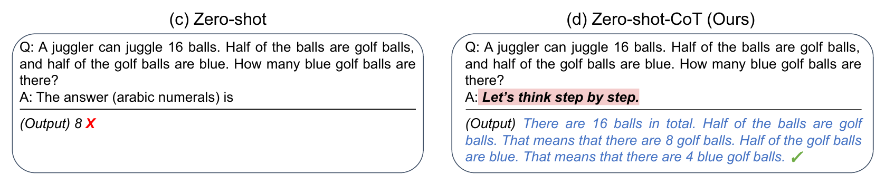

# The lay of the land

A few things worth knowing — so you choose well.

Not the detail. The **orientation**: what these things are, who makes them, and why
it matters which one you pick.

---

# You rent a brain — you don't build one

The model lives on a company's giant computers. You **rent access** to it. It does
not live on your laptop, and you are not going to train your own.

So when someone asks *"can you build me my own AI?"* — an **agent** is just this
rented brain, plus a few tools, plus a page of instructions. You already have one.

Training a frontier model costs north of **$100 million** and takes months. That's
why there's only a handful of makers — and why *they* update it, not you.

> **So:** you're not buying a machine. You're renting the smartest one going, by the
> month.

---

# A handful of top labs

- **Anthropic** — Claude *(this course)*
- **OpenAI** — GPT, and Codex *(this course)*
- **Google** — Gemini *(out for us: no filesystem access)*
- **China** — DeepSeek, Qwen, Kimi (open-weights)
- **Meta** (Muse), **xAI** (Grok)

Last 1 1/2 years: Claude, GPT, Gemini have been best at various points.

Currently GPT5.6 Sol and Fable 5 are best.

> **So:** today's "best" is a moving target. 

---

# They are not interchangeable

This is the one to remember.

Same request, different model: **different answer, different price, different speed,
different personality.** 

* Strong: GPT Sol, Claude Fable, Opus
* Medium: GPT Terra, Claude Sonnet
* Small: GPT Luna, Claude Haiku  

Use the strongest model you're willing to pay and wait for! 

---

# Why they keep getting better

- **Scaling** — more computing power, more data, a bigger model.
- **Thinking longer** — letting it work on your question before it answers.

> **So:** what it can't do this year, assume it can do next year.

---

# Benchmarks: useful, oversold

There are scoreboards — for coding, maths, reasoning. They climb fast and then
**saturate** (remember FrontierMath and the olympiad from earlier).

Read them for the **trend** — steep, and constantly leapfrogging — not as gospel.

> **So:** the only benchmark that matters is *your* task. Try it and see.

---

# Two ways to pay

- **Subscription** — flat monthly. Chat, plus Claude Code / Codex. **This is what you
  brought today.**
- **API** — pay per token, for wiring AI *into* software you build.

Tokens are the meter. (The same tokens that fill the desk — now you see they cost,
too.)

> **So:** For this course, use the subscription. You never have to think about the API.

---

# What it actually costs

API rates, per **million** tokens *(in / out)* — mid-2026, rough:

| | Strong | Medium | Cheap |
|---|---|---|---|
| **Claude** | Opus 4.8 · $5 / $25 | Sonnet 5 · $3 / $15 | Haiku 4.5 · $1 / $5 |
| **GPT-5.6** | Sol · $5 / $30 | Terra · $2.50 / $15 | Luna · $1 / $6 |

A million tokens is a *lot* — several novels' worth. In real work:

- a question + answer — **~1k tokens**
- cleaning a messy folder — **~50k** → about **40–50¢** strong, **~10¢** cheap
- a long coding session — **half a million+**

> **So:** which is why a flat subscription is a bargain once you use it daily.

---

# Prompt engineering (RIP)

- 2022 trick. add *"let's think step by step"* → maths 18% → 79%
- now built in. that's the **thinking** stage
- prompt tricks, templates, magic words? mostly noise now

---

# Prompting isn't a magic spell

You do **not** need to learn secret incantations.

**In stats:** The moment you say *"cube-root asymptotics,"* it's already in expert mode. 

**But** it can't see you. So tell it who you are and what you want:

> *"I teach first-year marketing. Explain it for that room."*

Context, not spells. And the durable version of "here's who I am" is a file it reads
every time — `AGENTS.md`.

> Give enough context for the LLM to see what you need.

---

# Conclusion

| Myth | Actually |
|---|---|
| "Build me my own AI" | you **rent** the best one, by the month |
| "AI = ChatGPT" | a handful of makers, leapfrogging monthly |
| "They're all the same" | **not interchangeable** |
| "The API is the real thing" | subscription is plenty for us; ignore the API |
| "I need prompt tricks" | skip the tricks, **give it context** |
