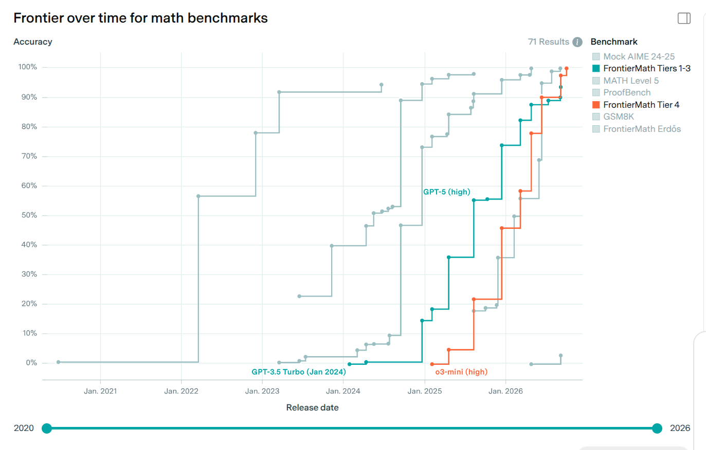
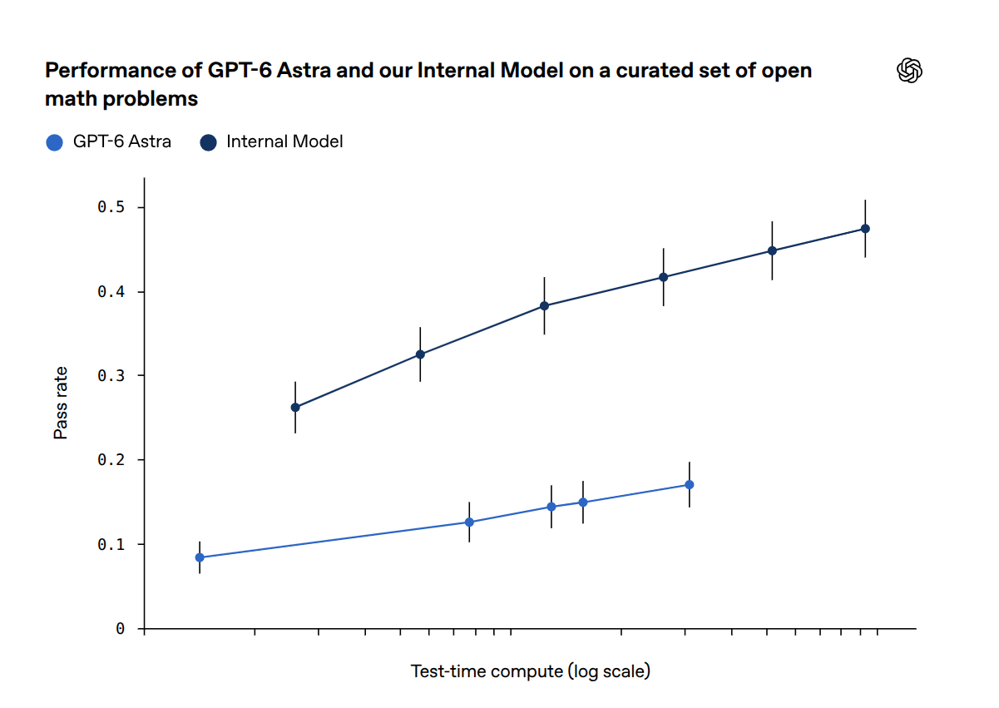

## Competitive programming: the world finals

::: {.pw-lead}
AtCoder World Tour Finals: the AI's score as a multiple of the best human's score.
Two divisions, each with its own scoring.
:::

```{=html}
<svg class="pw-chart" viewBox="0 0 1000 440" role="img"
     aria-label="AtCoder World Tour Finals, AI score as a multiple of the best human score. Heuristic division, July 2025: 0.9 times, and the human Psyho wins. Heuristic division, July 2026: about 8 times (about 50 billion against 6.3 billion points). Algorithm division, July 2026: 1.9 times (8,300 against 4,300 points).">
  <!-- scale: 36 px per 1x, baseline y=370 -->
  <line x1="170" y1="334" x2="950" y2="334" stroke="#17201f" stroke-width="2.5" stroke-dasharray="8 6"/>
  <text x="160" y="341" font-size="21" text-anchor="end" fill="#5c6763">Best human</text>
  <!-- Heuristic 2025: 1,654,675,725,406 / 1,812,272,588,909 = 0.913 -->
  <path d="M175,370 V341 Q175,337 179,337 H321 Q325,337 325,341 V370 Z" fill="#5c6763"/>
  <text x="250" y="322" font-size="27" font-weight="800" text-anchor="middle" fill="#17201f">0.9×</text>
  <text x="250" y="236" font-size="20" text-anchor="middle" fill="#5c6763">Psyho, a human, wins:</text>
  <text x="250" y="266" font-size="22" font-style="italic" text-anchor="middle" fill="#17201f">“Humanity has prevailed (for now!)”</text>
  <!-- Heuristic 2026: about 50 bn / about 6.3 bn = 7.9 -->
  <path d="M465,370 V88 Q465,84 469,84 H611 Q615,84 615,88 V370 Z" fill="#f0674d"/>
  <text x="540" y="66" font-size="30" font-weight="850" text-anchor="middle" fill="#17201f">about 8×</text>
  <text x="540" y="122" font-size="19" text-anchor="middle" fill="#17201f">50 billion vs</text>
  <text x="540" y="146" font-size="19" text-anchor="middle" fill="#17201f">6.3 billion points</text>
  <!-- Algorithm 2026: 8,300 / 4,300 = 1.93 -->
  <path d="M735,370 V305 Q735,301 739,301 H881 Q885,301 885,305 V370 Z" fill="#f0674d"/>
  <text x="810" y="287" font-size="27" font-weight="800" text-anchor="middle" fill="#17201f">1.9×</text>
  <text x="810" y="254" font-size="19" text-anchor="middle" fill="#5c6763">8,300 vs 4,300 points</text>
  <line x1="170" y1="370" x2="950" y2="370" stroke="#17201f" stroke-width="2"/>
  <text x="250" y="398" font-size="23" font-weight="700" text-anchor="middle" fill="#17201f">Heuristic</text>
  <text x="250" y="425" font-size="21" text-anchor="middle" fill="#5c6763">July 2025</text>
  <text x="540" y="398" font-size="23" font-weight="700" text-anchor="middle" fill="#17201f">Heuristic</text>
  <text x="540" y="425" font-size="21" text-anchor="middle" fill="#5c6763">July 2026</text>
  <text x="810" y="398" font-size="23" font-weight="700" text-anchor="middle" fill="#17201f">Algorithm</text>
  <text x="810" y="425" font-size="21" text-anchor="middle" fill="#5c6763">July 2026</text>
</svg>
```

::: {.small}
ICPC World Finals 2025: AI solves **12 of 12** problems, best human team **11**.
:::

::: {.notes}
The whole deck takes about 10 minutes. One message: these models are very strong,
said as plainly and soberly as possible. Mostly charts and numbers; two quotes in
all (Psyho's five words on the chart, and Duminil-Copin). The big maths results come from
OpenAI's internal model; the Astra slide (fourth) shows that a released model is
strong too, on the same kind of open problems.

About 2 minutes. These are the world finals of competitive programming: brand-new
problems, a fixed number of hours, no internet, a live scoreboard. For years this was
the standard example of something AI could not do.

Two divisions, scored differently, so each bar compares the AI with the best human in
that division. Heuristic: one open-ended optimisation problem over ten hours; the score
is whatever the problem's scoring rule gives, so "8×" means eight times the points, not
"eight times as clever". Algorithm: a set of exact problems, points per solved problem.

2025: Psyho (Przemysław Dębiak, a former OpenAI employee) beat OpenAI's model in the
ten-hour heuristic final, 1,812,272,588,909 points to 1,654,675,725,406, and posted
"Humanity has prevailed (for now!)". Heuristic problems are open-ended optimisation,
the division where humans held out longest.

2026: OpenAI's system scored roughly 50 billion; the best human, terry_u16, about
6.3 billion. "More than seven times the best human" (OfficeChai). The "Humanity
Prevails Award" for any human who beat it went unclaimed. The AI also won the
algorithm division, 8,300 points to 4,300 (tour1st). The competing system was
"comparable to GPT-5.6", a released model, with a compute harness around it.

ICPC 2025 (Baku): OpenAI's system solved all 12 problems; the best human team, 11.
If someone says "it memorised the answers": fresh problems, released at the start,
no internet, checked by the judges.

Sources: PC Gamer on Psyho (July 2025); OfficeChai and The Decoder on AtCoder 2026;
cphof.org standings; icpc.global/worldfinals/results-2025.
:::

## {#frontiermath .pw-full}

{.r-stretch fig-alt="Epoch AI chart: best score so far on maths benchmarks by model release date, 2020 to 2026. FrontierMath Tiers 1 to 3 (teal) rises from about 0% in early 2024 to about 90% in 2026; FrontierMath Tier 4 (orange) rises from 0% in early 2025 to nearly 100% in 2026."}

::: {.fragment .pw-overlay}
**FrontierMath:** unpublished problems written by mathematicians to stump AI. Tier 4
(orange) is research level.<br>
These tests are close to full, so the labs now also test on **open problems**.
:::

::: {.pw-corner}
Chart: [Epoch AI](https://epoch.ai/benchmarks), CC BY
:::

::: {.notes}
About 2 minutes, in your own words: when you noticed something big was happening
(around o4-mini-high, April 2025).

Reading the chart: each line is the best score so far, by release date. FrontierMath
is a set of unpublished problems written by mathematicians to be hard for AI; Tier 4
(orange) is research level. Tiers 1–3 (teal): about 0% in early 2024 to about 90%.
Tier 4: 0% with o3-mini in early 2025 to nearly 100%. The grey lines are older tests
that filled up earlier.

Show the chart alone first and talk it through; press next for the overlay. Its last
line paraphrases OpenAI's own explanation: "We expanded these evaluations after
performance on our existing mathematical evaluations saturated." It leads into the open-problems
slides that follow.
:::

## A released model on open problems

::: {.pw-lead}
OpenAI, September: a curated set of **open** maths problems, ones nobody had solved.
:::

:::: {.columns}
::: {.column width="62%"}
{height=390 fig-alt="OpenAI chart: pass rate on a curated set of open maths problems against test-time compute on a log scale. The internal model rises from about 0.26 to about 0.47; GPT-6 Astra rises from about 0.08 to about 0.17."}
:::
::: {.column width="38%" .pw-side}
**GPT-6 Astra**, released 3 September:
up to about **1 in 6**

**Internal model**, unreleased:
nearly **1 in 2**

The same Astra on FrontierMath Tier 4, the research-level test on the previous slide:
**97.6%**
:::
::::

::: {.small}
Claude users: on Epoch's capability index, Claude Fable 5.1 scores within two points
of GPT-6 Astra (164.5 against 166.3).
:::

::: {.pw-src}
[OpenAI, 8 September 2026](https://openai.com/index/navier-stokes-solution/) ·
Capability index: [Epoch AI](https://epoch.ai/eci), 20 September 2026 ·
Tier 4: [Epoch AI](https://epoch.ai/benchmarks/frontiermath-tier-4-v2), Astra at
medium reasoning, run data 20 September 2026
:::

::: {.notes}
About 1–2 minutes. This is the bridge from tests to open problems, and it answers the
question the next slides raise: the big maths results come from OpenAI's internal
model, which nobody outside OpenAI can use. What about the models you can buy?

On the same kind of open problems, the released GPT-6 Astra solves roughly 8% to 17%,
depending on how long it thinks (the x-axis is compute, on a log scale). The internal
model gets 26% to 47%. The internal model is far ahead, but a model you can buy
already solves some open research problems. On Epoch's FrontierMath Tier 4 (the
orange line on the previous chart), Astra at medium reasoning scores 97.6%.

For Claude users: Epoch's capability index combines many benchmarks into one scale.
In the 20 September snapshot, GPT-6 Astra scores 166.3 and Claude Fable 5.1 scores
164.5; the uncertainty intervals overlap. The two are in the same class.

What we don't know: OpenAI chose the problems, and the set is not public. Treat the
levels as OpenAI's own numbers. Epoch's 97.6% is independent; Epoch allows written
working and Python, and its June update fixed errors in many Tier 4 problems.
:::

## Navier–Stokes

::: {style="font-size: 1.2em; line-height: 1.5;"}
One of the seven **Millennium Prize Problems**. \$1 million each.

**September 2026:** OpenAI reports a solution from an internal model: about
**10,000 concurrent agents**, **88 hours**. The proof is checked by computer.
:::

::: {.pw-src}
[OpenAI, 8 September 2026](https://openai.com/index/navier-stokes-solution/) ·
[Clay Mathematics Institute](https://www.claymath.org/millennium-problems/)
:::

::: {.notes}
About 1 minute. Lead with prestige; do not teach fluid mechanics. The equations
describe how fluids flow; the question is whether their solutions can blow up.

Details if asked: an unreleased model that OpenAI calls "significantly more capable"
than GPT-6 Astra; about 10,000 agents running at once in the successful group; 88
hours to the result and 17 more to formalise it in Lean (a programming language in
which a computer checks a proof step by step). The result is
the forced-flow version (statements C/D of the Clay problem). No prize has been
awarded. It builds on earlier human work, including Alpöge and Buckmaster.
:::

## 6 October: the same internal model

::: {.pw-lead}
OpenAI posed about 4,000 **open** problems to it, as a test: problems nobody had solved.
:::

::: {.pw-stats}
::: {.pw-stat}
**4,000**
[open problems tried]{}
:::
::: {.pw-stat}
**372**
[results]{}
:::
::: {.pw-stat}
**719**
[papers]{}
:::
::: {.pw-stat}
**3 hours**
[of compute per result]{}
:::
::: {.pw-stat}
**42%**
[checked by computer]{}
:::
:::

::: {.fragment style="text-align: center; margin-top: 0.4em; font-size: 0.8em;"}
By one count, **90 of the 500** best-known open problems in mathematics.
:::

::: {.pw-note style="text-align: center;"}
OpenAI: "Some of the unformalized results could have issues." Three papers were
withdrawn in the first two days.
:::

::: {.pw-src}
[OpenAI, 6 October 2026](https://openai.com/index/sharing-ai-progress-in-mathematics/) ·
[github.com/openai/math](https://github.com/openai/math)
:::

::: {.notes}
About 2 minutes. Same model family as Navier–Stokes, on about 4,000 problems at once.
Released as a dump on GitHub: 719 manuscripts in 372 families, no human authors.
"On average, each result used three hours of ChatGPT Pro thinking compute." Most came
from a single fixed prompt.

About 42% of the main results are checked by computer (Lean). OpenAI: "Some of the
unformalized results could have issues." Three papers were withdrawn within two
days, all from one sign error, all in the unchecked part (722 at release, 719 now).

The "90 of 500" is one online tally (Lech Mazur via Proof of Atlas, quoted by Zvi
Mowshowitz), not checked by us; hence "by one count".

The 4,000 were a test set, not a hand-picked showcase: "As part of model development,
we evaluate our models on open research problems. We expanded these evaluations after
performance on our existing mathematical evaluations saturated." (repository README)

Scott Aaronson's wife, the complexity theorist Dana Moshkovitz, had worked for
decades towards the Unique Games Conjecture (2002). It is in the dump, Lean-checked.
Their nine-year-old: "Mommy, I heard you got cooked!"
:::

## The biggest day in history?

::: {.pw-quote}
> It isn't an overstatement to say that this is probably the biggest day of
> scientific advancement in history.
:::

**Joshua Gans**, economist, Rotman School of Management, Toronto

::: {.pw-quote}
> Big, big, big, big props for quasiriemann and no Siegel zeroes […] It's obviously
> the most significant moment in mathematical history.
:::

**Levent Alpöge**, mathematician at Anthropic, on OpenAI's results

::: {.fragment .small}
The New York Times front page that day had no mathematics.
:::

::: {.pw-src}
[Joshua Gans, 7 October 2026](https://joshuagans.substack.com/p/openai-drops-a-bomb-on-maths) ·
[Alpöge on X, 7 October 2026](https://x.com/__alpoge__/status/2107616859595981117)
:::

::: {.notes}
About 2 minutes. Gans's claim is very large, so pair it with a mathematician. Gans is
an economist at a business school, not an AI insider; he has written around 40
papers in two years with these tools. Alpöge works at Anthropic, OpenAI's direct
competitor, and still calls OpenAI's day the most significant in mathematical
history. His post goes on: there are "sad stories" of people getting scooped, but
"we should put that aside for today though."

What he is praising, if asked:

- Quasi-Riemann: a zero-free strip for the zeta function (Re(s) > 11/12). Not the
  full Riemann Hypothesis, the most famous open problem in mathematics, but a big
  step towards it; checked by computer. Alex Kontorovich: "If a human did this, it
  would be an instant Fields Medal."
- No Siegel zeros: a second long-standing obstacle in number theory, settled in a
  sibling paper.
- Other Millennium Prize Problems with partial results in the dump: Hodge (special
  cases) and Birch–Swinnerton-Dyer (an exact formula in a special case).

The fragment: Gans opens his post with that day's New York Times front page; the
news was elsewhere.
:::

## A Fields medallist's reaction

::: {.pw-quote}
> Not a single one of the major open problems I have publicly mentioned throughout
> my career […] was left untouched by the announcement. Everything has been claimed
> to be proved.
>
> I expected to see a few of them in the list. But not all of them. Not all at once.
:::

**Hugo Duminil-Copin**, Fields Medal 2022

::: {.fragment}
"The shock is immense. I am paralysed. Tomorrow, we will find a way forward."
:::

::: {.pw-src}
[Proofs and Prompts: 100+ reactions to 100+ solutions, 8 October 2026](https://proofsandprompts.com/2026/10/08/100-reactions-to-100-solutions/)
:::

::: {.notes}
About 1 minute; read it slowly, then pause. Duminil-Copin is French, at IHÉS near
Paris and the University of Geneva; Fields Medal 2022 for phase transitions in
statistical physics. The cut passage lists where he had mentioned these problems:
"whether in a talk, a lecture, an article, or even a grant proposal". He goes on:
"We will rethink our profession and how we work. We are a resilient community, and
I have no doubt that we will adapt."
:::

## For teaching: animations, written as code

{height=400 fig-align="center" fig-alt="Animated explainer: saving 1,000 dollars a year at 7 percent for 40 years. The bars grow year by year; the interest part overtakes the savings part. After 40 years the total is about 200,000 dollars: 40,000 saved and 160,000 interest."}

::: {.prompt .small}
Make a 15-second animated SVG that explains [compound interest] to first-year
students. Three scenes, one caption each.
:::

::: {.pw-src}
Made by Claude Code for this slide: one SVG file, no video software. Also in the Claude app:
[Design animations](https://aiblewmymind.substack.com/p/claude-design-animations),
[Motion](https://support.claude.com/en/articles/17454997-get-started-with-claude-motion).
:::

::: {.notes}
About 1 minute; let it play once. Not research, but for teaching it may be the
biggest thing in this deck. Claude writes the animation as code (here an SVG file with
CSS animation), so it plays in any browser, needs no video software, and you can
change one number, one caption or the timing and ask again. Many colleagues know
NotebookLM's video overviews, which summarise sources you give it; this is your own
explainer, scene by scene, on exactly the point you want to teach.

In the Claude app: Claude Design animations (beta since summer, Pro, Max, Team and
Enterprise) and Claude Motion (beta from 8 October, Team and Enterprise only, MP4
export). In Claude Code or Codex, any plan: just ask for an animated SVG or HTML file.

The numbers: \$1,000 at the end of each year at 7%, 40 years: \$199,635, of which
\$40,000 was saved.
:::
