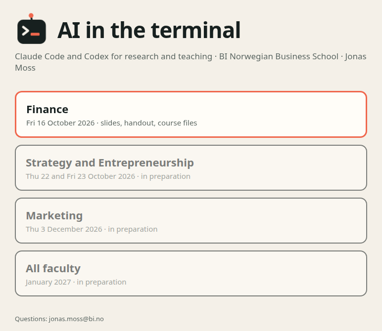

# Save points {#git background-color="#f0674d"}

Git: mainly for the agent. Very, very good for you too.

## What git is {#what}

- **Git records the history of a folder:** every change, when, and why.
- **Software can't be built without it:** millions of lines, thousands of people.
- **Every change can be seen before it's accepted,** and undone after.
- **Many people work at once,** and git merges their changes.

## Where git comes from {#history}

```{=html}

```

[The tool almost all software is built with.]{.punch}

## Almost every developer uses it {#survey}

```{=html}

```

[Version control used by professional developers. Stack Overflow developer survey,
2022; 53,374 answers.]{.small .muted}

## GitHub: where git lives online {#growth}

```{=html}

```

[Developers on GitHub, as GitHub announced them. Microsoft bought GitHub in 2018
for \$7.5 billion.]{.small .muted}

## Mainly for the agent {#agent}

```{=html}

```

[It changes 40 files in 30 seconds. You can't check that by looking.]{.punch}

## "What changed?" {#diff}

```{=html}
<div class="diff">
  <div class="file">paper/methods.md</div>
  <div class="del">− We interviewed 14 founders.</div>
  <div class="add">+ We interviewed 12 founders; the two pilot interviews are dropped.</div>
  <div class="file">tables/table2.csv</div>
  <div class="del">− Mean age, 41.2</div>
  <div class="add">+ Mean age, 40.8</div>
  <div class="file">notes/log.md</div>
  <div class="add">+ 20 Oct: dropped the pilots, reran Table 2.</div>
</div>
```

[Every file, every line, in one list.]{.punch}

## The agents insist on it {#insist}

> Codex requires commands to run inside a Git repository to prevent destructive
> changes.

[OpenAI's manual for Codex. And what it says in a folder without git:]{.small .muted}

```{=html}
<div class="term">
  <div class="you">codex exec "check these facts"</div>
  <div>Not inside a trusted directory and --skip-git-repo-check was not specified.</div>
</div>
```

## Very good for you too {#you}

- **Nerve.** Let it try something bold. Hate it? Revert.
- **One file, every version.** No more `paper_v3_FINAL_jm.docx`.
- **A history you can ask about.** *"When did we drop the pilots, and why?"*

> Track Changes, for a whole folder, with a note on every change.

## A first save point {#try1 .your-turn background-color="#f1c84b"}

In your `practice` folder, with the agent running:

1. *"Set up git here. My name is …, my email is …"*
2. *"Make a file notes.md with one line about my research. Commit it."*
3. *"Add a second line."* Then: *"What changed since the last commit?"*

[Three minutes. Prompts with copy buttons: handout, section 2.]{.small}

## Save points on a line {#timeline}

```{=html}

```

- Every **commit** is the whole folder, with a note.
- Not happy since the last one? **Revert.**

## Undo {#try2 .your-turn background-color="#f1c84b"}

1. *"Revert to the last commit."* The second line is gone.
2. *"Show me the history."*

**Done early?** *"Make a branch called experiment, add a line there, then switch
back to main. Where did the line go?"*

## Isn't this just OneDrive? {#onedrive}

::: {.diagram-lg}
```{=html}

```
:::

## Undo the agent's 40 edits {#undo40}

```{=html}

```

> OneDrive is a backup. Git is a lab notebook. Keep both.

## Keep things out: .gitignore {#ignore}

```{=html}

```

- **Ignore before the first commit.** After that, it's in the history.
- **Ignored by git is not hidden from the agent.** That's the next deck.

## A research project {#try3 .your-turn background-color="#f1c84b"}

A made-up study of founders: interviews, a survey, papers, a draft.

1. **Get it:** the download prompt is in the handout, section 2.
2. *"Go into founders-study. Set up git, but don't commit yet. Tidy the folders,
   and show me the plan first."*
3. *"Write a .gitignore. Explain each line in plain words."*
4. *"Commit. What did git leave out, and why?"*

**Check:** *"If I pushed this to GitHub, would anything private go along?"*

## The cloud: remote, push, pull {#cloud}

```{=html}

```

- **No remote?** Then nothing leaves your laptop.

## Five words, one picture {#words}

```{=html}

```

[You never type a git command. But the agent uses these words.]{.punch}

## You'll hear them back {#hear}

```{=html}
<div class="term">
  <div class="you">Commit this.</div>
  <div class="agent">Committed <b>a1b2c3d</b>: "Drop pilot interviews, rerun Table 2".</div>
  <div class="you">Is there a remote?</div>
  <div class="agent">No remote configured. Everything is local.</div>
  <div class="you">Put it on GitHub as a private repository, and push.</div>
  <div class="agent">Created founders-study (private). Pushed 3 commits to <b>origin/main</b>.</div>
</div>
```

[Careful: *revert **to** the last commit* goes back to it. *Revert the last
commit* undoes it.]{.small .muted}

## Unsure what a word means? Ask. {#ask}

```{=html}
<div class="chips">
  <span>repo</span><span>diff</span><span>log</span><span>branch</span><span>merge</span>
  <span>clone</span><span>origin</span><span>main</span><span>HEAD</span><span>stash</span>
  <span>rebase</span><span>fork</span><span>tag</span><span class="hot">worktree</span>
  <span>pull request</span><span>.gitignore</span>
</div>
<div class="term">
  <div class="you">What's a worktree? Two sentences, for a professor.</div>
  <div class="agent">A second working folder for the same repository, on its own branch. Two agents can work on one project at once without touching each other's files.</div>
</div>
```

**Your turn:** pick any word above, and ask.

## GitHub: what it's for {#github}

```{=html}

```

[Setup, co-authors and a live demo: the GitHub deck.]{.small .muted}

## A free web page: GitHub Pages {#pages}

:::: {.columns}
::: {.column width="47%"}
- **A folder becomes a web page.** Free.
- **This course's page is one.**
- **Public is fine** for teaching pages. Private? Free academic plan.

::: {.prompt}
Publish this folder as a web page with GitHub Pages.
:::
:::
::: {.column width="53%" .shot}

:::
::::

## What people ask about GitHub {#github-faq}

```{=html}
<div class="qa">
  <div><b>Who can see it?</b><span>Private: you and the people you invite.</span></div>
  <div><b>Is my data safe there?</b><span>Same rules as OneDrive: nothing personal or confidential.</span></div>
  <div><b>Can I delete it later?</b><span>It stays in the history. Keep data out from the start.</span></div>
  <div><b>Does it train AI on it?</b><span>Copilot won't train on repositories it indexes, GitHub says.</span></div>
</div>
```

## Quick answers {#faq}

```{=html}
<div class="qa">
  <div><b>Word and Excel files?</b><span>Every version is kept, but no line-by-line "what changed".</span></div>
  <div><b>A OneDrive folder?</b><span>My advice: keep git projects outside it.</span></div>
  <div><b>Claude Code's own undo (Esc twice)?</b><span>It misses files that commands moved or deleted. Git doesn't.</span></div>
  <div><b>Committed something by mistake?</b><span>Ask before you push: it can still come out of the history.</span></div>
</div>
```

# Commit first, then courage {#close background-color="#f0674d"}

Before you let it loose, and again when it works.
