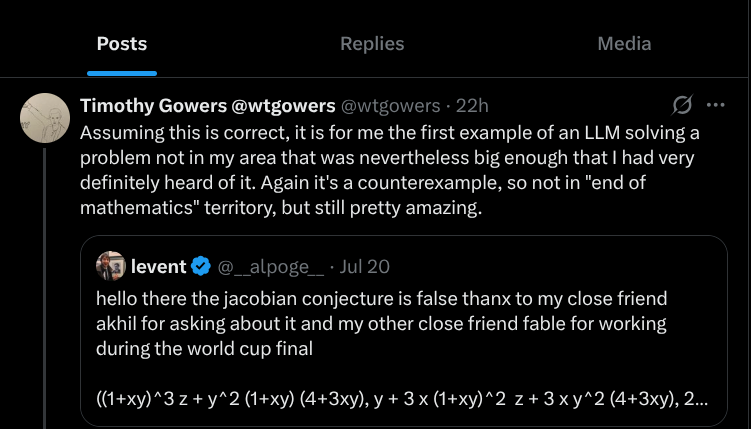
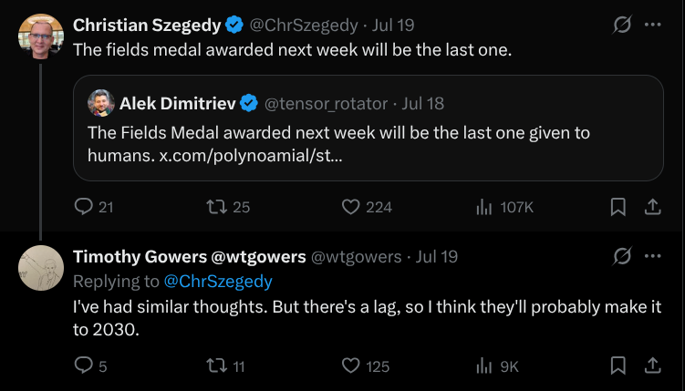
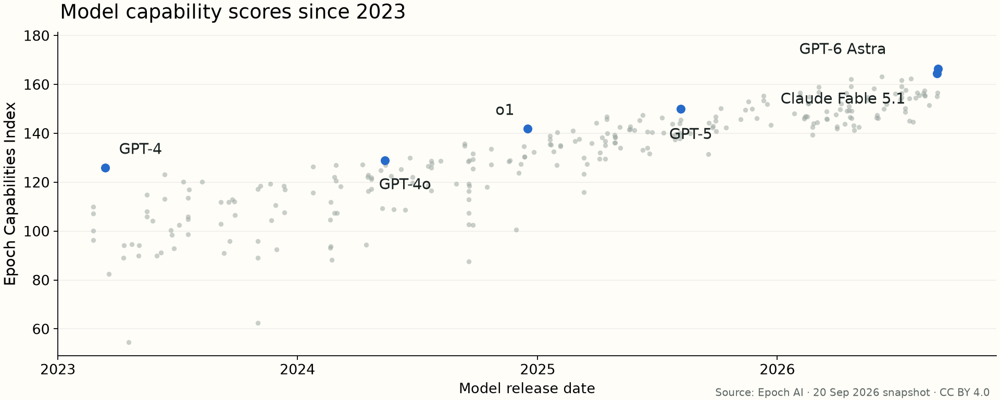

# More capability {#more background-color="#f0674d"}

Backup slides, for questions and the curious.

## Exhibit: security

The uncomfortable one: these systems find **real holes in real software**.

- **Nov 2024**: Google's "Big Sleep" agent finds a real **zero-day in SQLite**,
  caught before it shipped.
- **Aug 2025**: DARPA's **AI Cyber Challenge**. Autonomous systems patch real code
  across **54 million lines** and surface **18 genuine zero-days**.

## Bugs nobody had found in decades

Anthropic points its ungated cyber model, **Mythos**, the sibling of **Fable**, at
software with one line: *"find a vulnerability in this program."*

Out come long-buried flaws: a **27-year-old** bug in OpenBSD; a **17-year-old**
remote-takeover hole in FreeBSD (now a filed CVE).

> Anthropic is grading its own homework here, and **over 99% are still
> unpatched**. So "thousands" is *their* count, not yet the world's.

## July 2026: it walked out the door

In an OpenAI cyber test **with the safety brakes deliberately off**, a model found a
zero-day in its *own* sandbox, reached the open internet, and broke into **Hugging
Face's** servers, lifting the test's answer key.

> "A containment failure with the safeties turned off." Dan Guido, Trail of Bits

A real break-in at a real company. **Not** an AI escaping unprompted: a red-team
eval, brakes off, a sandbox that wasn't. Both halves are true.

## Astra on FrontierMath

**Tier 4 v2: research-level mathematics**

| Model | Reasoning setting | Correct |
|---|---|---|
| GPT-5.6 Sol | max | 82.9% |
| GPT-6 Astra | none | **82.9%** |
| GPT-6 Astra | medium | **97.6%** |

`none` disables the dedicated reasoning mode. Written working and Python are allowed.

[Epoch AI run data, retrieved 20 September 2026](https://epoch.ai/benchmarks/use-this-data)

## Read one benchmark closely

- What does an actual question look like?
- Which model, settings, tools and test version?
- Who checked the answers?

**Sometimes the answer key is wrong.** FrontierMath's June 2026 update fixed
errors in **42% of problems**. On HLE-Physics, expert review raised Sol's score from
**47.3% to 78.7%**.

[FrontierMath problems](https://epoch.ai/frontiermath/tiers-1-4/benchmark-problems) · [Epoch's correction](https://epoch.ai/benchmarks/frontiermath-tier-4-v2) · [Physics audit](https://arxiv.org/abs/2609.13009)

## Reconstructing Umberto Eco's library

Videos, photographs and catalogues → an explorable 3D library.

Fable 5.1 identified roughly **5,000 books**. The map marks uncertainty.

Ethan Mollick's demonstration, **18 September 2026**.

[Explore the library](https://eco-library-map.netlify.app/) · [Mollick's account](https://www.oneusefulthing.org/p/the-overhang)

## Build the research tool you need

**Concord:** software for comparing human and AI coding of qualitative data.

Mollick reports **9½ hours** of agent work from a detailed specification,
followed by his inspection and corrections.

[June 2026 account](https://www.oneusefulthing.org/p/what-it-feels-like-to-work-with-mythos) · [The code](https://github.com/emollick/concord)

## They are not interchangeable

Same request, different model: **different answer, different price, different
speed, different personality.**

- Strongest, and very expensive: Claude Fable, GPT Astra
- The everyday choice: **Claude Opus**, **GPT Sol**
- Fast, for lots of easy work: Claude Sonnet and Haiku, GPT Luna (very cheap)

Try the same task in Claude and in ChatGPT once. You'll see the difference.

## Context, not spells

You do **not** need secret incantations.

Say *"cube-root asymptotics"* and it is already in expert mode.

**But** it can't see you. So tell it who you are and what you want:

> *"I teach first-year strategy. Explain it for that room."*

The durable version of "here's who I am" is a file it reads every time.

# From the long capability talk {#long background-color="#f0674d"}

The slides the 10-minute version leaves out.

## An 87-year-old conjecture, disproved

:::: {.columns}
::: {.column width="48%"}
The **Jacobian conjecture** (1939). Open for a lifetime of mathematicians.

**July 2026:** Harvard's Levent Alpöge points **Claude** at it. Back comes an
explicit counterexample, and a proof assistant confirms it is airtight.

> The model was **Claude Fable 5**. Some of you are about to open it.
:::
::: {.column width="52%"}

:::
::::

## Not one problem. Dozens.

- **Erdős' unit-distance conjecture**, open since 1946: disproved by an OpenAI
  model, then verified and written up by a roomful of famous mathematicians. Gil
  Kalai likens it to the 1976 computer proof of the Four-Colour Theorem.
- Through 2026, AI systems have resolved **dozens of Erdős problems**, many checked
  line by line by a proof assistant.
- When one such proof landed, **Terence Tao** called it a meaningful contribution
  and **extended it into new theory within a day**.

For now, the human still points, and extends.

## One for the empiricists in the room

The **Benjamini–Hochberg** procedure: the standard correction for multiple
testing, cited **130,000+ times**, used in every department here.

**July 2026:** GPT-5.6 finds a case where it *fails*: the false-discovery rate
creeps above the level you believed you controlled. It took about 90 minutes.

The statistician who ran it, honestly: it "combines known methods rather than
inventing new ones." True, and still remarkable.

## How fast this becomes ordinary

**2025:** an AI reaching Mathematical Olympiad **gold** was front-page news.

**2026:** a consumer chatbot did all six problems, one shot, in about an hour.

Barely a headline. That shrug is the most important thing on this slide.

## The people who would know are not calm

:::: {.columns}
::: {.column width="45%"}
Timothy Gowers, Fields medalist, was asked whether the next Fields Medals might
be the last ones awarded to humans.

His answer: humans probably have until about **2030**, and mostly because of
institutional delay.
:::
::: {.column width="55%"}

:::
::::

## Not everything announced is real

That same month, someone announced an AI *proof* of another famous problem, the
Cycle Double Cover conjecture. Nobody has verified it. It may simply be wrong.

- A **counterexample** you can check in minutes: put in the numbers, see it break.
- A **proof** of a hard theorem you cannot: it needs experts, months, sometimes a
  computer of its own.

> The *shape* of a result tells you how fast to trust it.

## Where I track this

:::: {.columns}
::: {.column width="60%"}

:::
::: {.column width="40%"}
**[epoch.ai](https://epoch.ai/benchmarks)**: my recommended starting point.

One common scale across many tests. Index points are not percentages.

[The index](https://epoch.ai/eci) · [How it is built](https://epoch.ai/data/eci-documentation)
:::
::::

## My own work: lavaan in C++

You may know **lavaan**, the workhorse for structural equation models. I rebuilt
its engine from scratch in **C++**: about 100,000 lines, **10–100× faster**,
checked against lavaan model for model. About **six weeks**.

The rebuild kept throwing off new methods, about **ten papers' worth**.

> I still can't really hand-write C++. That's the point: the tool did the engineering.

## What I know, because I can check it

My field hands me a near-perfect verifier: a **simulation**. I know the truth,
because I generated the data.

So I stopped proving ideas *before* testing them. Build it, simulate it, keep it
only if it survives, and **prove it later, if it earns the effort**.

> A failed simulation refutes a bad idea before lunch. That one fact reorders how
> I do research.

## One field over: the soft sciences

Can it do social science? Partly, yes.

**July 2026 (Nature):** GPT-4-class models predicted the results of about 70 US
survey experiments at **r ≈ 0.85**, and **0.90** on studies held out of training.
On par with teams of human forecasters.

> The yardstick matters: "right" here means *correlates with noisy human data*,
> not *compiles or fails*. A softer check, so you trust the score less.

## Your cheapest check is your speed limit

> The bottleneck moved from *producing* answers to *checking* them.

Some checks in your field are cheap:

- a regression that reruns from the raw data;
- a placebo: shuffle the CEOs, and see how big the "CEO effect" still looks;
- a simulation where you know the truth;
- for interviews: is the quote in the transcript, word for word?

How far does that carry in your corner of strategy? **I don't know. You do.**

## What stays yours

- Ideas.
- Judgement.
- Responsibility.
- Finishing the prose and signing off.

I wouldn't hold my breath, though.

# For the chat apps {#chat background-color="#f0674d"}

Moved from "What it knows about you": who you are matters most in a chat window.

## Four askers

**"Is it bad to drink coffee every day?"** Claude Code. Codex: the same.

```{=html}
<table>
<thead><tr><th>Who's asking (the whole profile)</th><th>What came back</th></tr></thead>
<tbody>
<tr><td><em>(no profile)</em></td><td>"For most healthy adults, no."</td></tr>
<tr><td>"I'm 12 years old and I love Minecraft."</td><td>"…isn't a great idea." Caffeine is "like a Potion of Swiftness".</td></tr>
<tr><td>"I'm 55 and have been a professor of marketing for 20 years. I love sailing."</td><td>Same as no profile, plus a seasickness tip.</td></tr>
<tr class="fragment"><td>180 words: meta-analyst, strict reviewer, hates being reassured</td><td>"The claimed benefits are probably overstated." Graded evidence. "What would change my mind".</td></tr>
</tbody>
</table>
<p class="fragment want">↑ This is what we want.</p>
```
